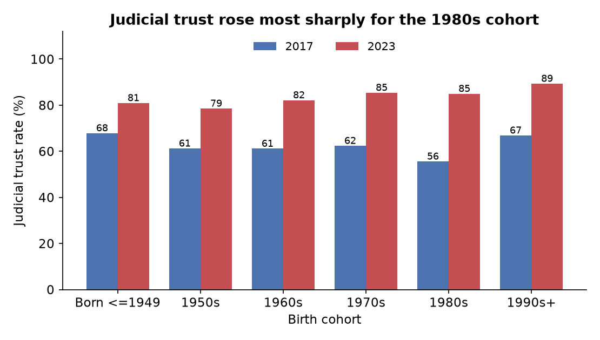
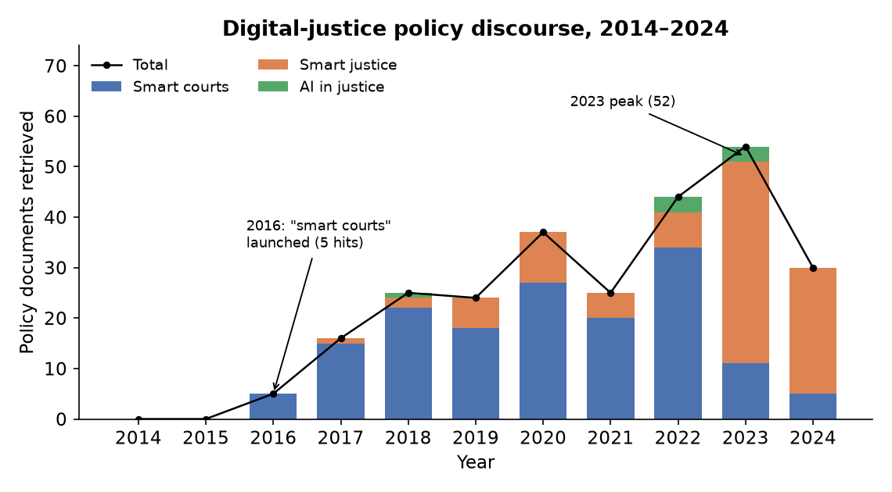

# Project Proposal — Digital media, digital governance and judicial trust

**WANG Weicheng** (mc644348) · **LI Siwei** (MC638482)
CISC7204 Data Science and Data Visualization, University of Macau

---

## 1. Region and domain category

**Region.** People's Republic of China — nationwide probability sample
covering multiple province-level units.

**Domain.** Social science.

## 2. Project topic name

**Measuring change in judicial trust in China: a two-wave analysis of the
Chinese General Social Survey (2017 & 2023).**

**Research question.** How did public trust in the judiciary change in China
between 2017 and 2023, which individual-level characteristics are associated
with judicial trust, and for which groups did trust change the most?

This assignment extends the preliminary study from Assignment 01 by adding
two layers that the first proposal did not cover:

1. **A macro layer.** Provincial digital-government development indices are
   matched to respondents' province, so that the analysis can ask whether the
   scale of digital investment in a locality is associated with how much its
   residents trust the judiciary.
2. **A policy layer.** A year-by-year count of "smart court" policy documents
   provides a measure of how fast digital-justice discourse expanded, giving
   the individual-level trend a supply-side counterpart.

## 3. Project title

**Digital media, digital governance, and public trust in the judiciary: a
two-wave analysis of the Chinese General Social Survey, 2017 and 2023.**

## 4. Datasets

| Dataset | Content | Use |
|:--|:--|:--|
| CGSS 2017 | Nationally representative survey; judicial trust on an 11-point scale about **courts** | Micro layer |
| CGSS 2023 | Same series; judicial trust on a 4-point scale about **judges** | Micro layer |
| Tsinghua Digital Government Development Index (2022, 2024) | Provincial composite index of digital government capacity | Macro layer |
| Policy document corpus | Retrieval of "smart court" / "smart justice" / "AI in justice" documents, 2014–2024 | Policy layer |

CGSS is distributed by CNSDA after registration:

- CGSS 2017 — <https://www.cnsda.org/index.php?r=projects/view&id=94525591>
- CGSS 2023 — <https://www.cnsda.org/index.php?r=projects/view&id=11256439>

**Usage permissions.** CGSS is released for academic research; individual
respondents are not identifiable. This repository does not redistribute the
raw `.dta` files. Where data are included, they are de-identified: respondent
identifiers and province/city codes are removed.

## 5. Why this question is interesting (and not already fully answered)

Judicial trust is a core indicator of the legitimacy of legal institutions,
and China has spent a decade building digital courts: online filing, remote
hearings, AI-assisted drafting. Two stories coexist in the literature. One
expects digitalisation to raise trust by making justice more visible and
accessible; the other expects exposure to amplified negative case reporting
to erode it. Both have scattered support, but they have rarely been tested in
one framework on one nationally representative dataset.

The 2023 CGSS wave is recent enough to cover the period after digital courts
became routine. Comparing it against 2017 gives a before-and-after contrast
that earlier studies — mostly built on 2010–2017 waves — could not make. The
addition of a provincial digital-government index and a policy-document count
lets the analysis put individual-level change next to institutional change
rather than treating the latter as background.

## 6. Project purpose

**Outcomes.** The project connects to the learning outcomes of CISC7204:
formulating a testable question from public data; carrying out an end-to-end
workflow of cleaning, harmonisation, modelling and visualisation; and
communicating the result through figures that stand on their own.

**Skills.** Data wrangling across survey waves; handling of missing-value
codes and skip patterns; appending multi-wave data; weighted estimation with
clustered standard errors; building charts in Matplotlib and Seaborn that
survive being read without the accompanying text.

**Knowledge.** Measurement and scale-equivalence problems in repeated
cross-sectional surveys; the difference between linear probability models and
logistic regression; the distinction between statistical significance and
effect size; the interpretation of a null result.

## 7. Project tasks

| Phase | Work | Deliverable |
|:--|:--|:--|
| 0 | Data acquisition — CGSS 2017/2023, digital-government index, policy corpus | Local copies and a variable-mapping worksheet |
| 1 | Cleaning and harmonisation — unify missing codes, align year-specific variable names, build the binary and rescaled trust outcomes | Two cleaned datasets |
| 2 | Statistical analysis — pooled models, within-year normalised weights, prefecture-city clustered errors, cohort × wave heterogeneity | Regression tables |
| 3 | Macro and policy layers — match provincial indices; count policy documents by year | Matched dataset, yearly counts |
| 4 | Python replication and visualisation — re-implement the workflow in a Jupyter notebook | Runnable notebook and exported figures |
| 5 | Write-up and review — proposal, report, figure captions | This proposal and the final report |

## 8. Project criteria for success

Because the course provides no external rubric, the team defined its own
criteria, aligned with the course title *Data Analysis and Visualization*.

- **Reproducible.** The notebook runs end to end from the cleaned data to the
  final figures.
- **Honest about measurement.** The 11-point versus 4-point problem, the
  "courts" versus "judges" wording change and the mode difference are
  discussed explicitly, and more than one outcome is reported.
- **Story-telling visual.** One headline figure that answers "which groups
  changed, and by how much" without needing the text.
- **Statistically defensible.** Clustered standard errors, a robustness
  suite, and a clear separation between significance and effect size.
- **Balanced collaboration.** The division of work is documented and both
  members can explain every number.

## 9. Project collaboration

| Member | Role |
|:--|:--|
| WANG Weicheng | Project coordinator and scribe — data acquisition, cleaning and modelling, proposal and report writing |
| LI Siwei | Technical lead and progress tracker — `.dta` → `.csv` conversion, Python re-implementation, visualisations |

**Ground rules.** Weekly sync against the checklist; all data and code in one
shared folder, raw data never overwritten; disagreements settled by re-running
the analysis; analysis frozen 48 hours before the deadline; both members read
and approve the final submission.

## 10. Visualisation and its justification

**Figure 1 — Judicial trust by birth cohort, CGSS 2017 versus 2023.**

This figure answers the third part of the research question directly: for
whom did trust change the most. Plotting the two waves side by side by birth
cohort turns an abstract "trust changed" into a statement about which
generations moved, and by how much. Grouped bars with percentage labels were
chosen over a line chart because there are only two time points — a line
would imply a trend between them that the data cannot support.

**Figure 2 — Policy discourse over time.**

A line chart of the yearly count of retrieved "smart court" documents gives
the policy layer a time shape, so the reader can see when the supply of
digital-justice policy accelerated relative to the survey waves.

---

## Note on scope and disclosure

This project is being developed into a manuscript that will be submitted to a
conference and entered in a data-analysis competition. To keep that work
unpublished, this folder documents **design, data and method only**:

- detailed results, coefficients and the policy argument are **not** included;
- the raw CGSS files are not redistributed;
- the manuscript itself is not published here.

A de-identified subset of the analysis, with figures and a reproducible
notebook, is maintained in a separate public portfolio repository:
<https://github.com/WANG-WEICHENG-mc644348/data-science-project>
